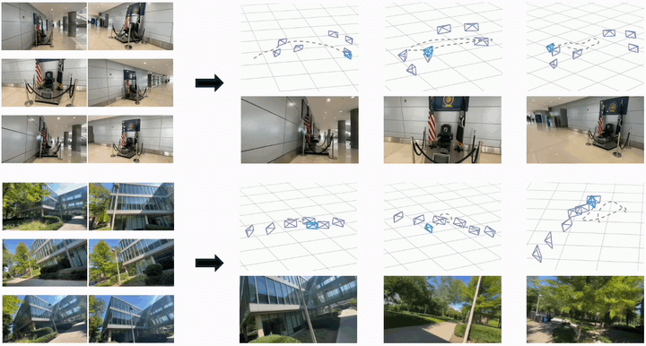

<p align="center">
  <h1 align="center"><sub><sub><sub></sub></sub></sub> RoGe: Novel View Synthesis via<br>End-to-End Implicit Reconstruction and Generation</h1>
  <p align="center">
    <a href="https://arxiv.org/abs/2609.02847">
      
    </a>
    <a href="https://arxiv.org/pdf/2609.02847" style="padding-left: 0.5rem;">
      
    </a>
    <a href="https://jerry-locker.github.io/roge/" style="padding-left: 0.5rem;">
      
    </a>
    <a href="https://huggingface.co/Jerry-locker/RoGe" style="padding-left: 0.5rem;">
      
    </a>
  </p>
</p>

RoGe introduces an **end-to-end** reconstruction and generation framework (**without any explicit 3D**) for novel trajectory video synthesis with sparse inputs, achieving state-of-the-art performance on image and video metrics.

<br>

<p align="center">
  
</p>


### 📢 News

- [2026-10-23] Model weights for both `192×336` and `480×832` resolutions are fully released.
- [2026-10-21] Full source code is released, including training, inference, and benchmarking.
- [2026-09-04] The first version of the paper is available on arXiv. [[`Paper`](https://arxiv.org/pdf/2609.02847)] [[`Page`](https://jerry-locker.github.io/roge/)] [[`RedNote`](https://xhslink.cn/o/1rj6LoVBTQJ )] 

### 💌 Contact

Questions? Please don't hesitate to reach out to Xiaolei Lang (Jerry) at [jerry_locker@zju.edu.cn](mailto:jerry_locker@zju.edu.cn).

## Quick Start

1. Prepare Conda environments.

   **`roge`**, for `scripts/prepare_models.sh`, `demo.py`, `evaluation/*/*_eval.sh`, and `training/train_*.sh`.

   ```shell
   conda create -n roge python=3.10 -y
   conda activate roge
   pip install -r requirements.txt
   ```

   **`roge-metrics`**, for `evaluation/*/*_run_metrics.sh` and `evaluation/*/*_run_ape.sh`.

   ```shell
   conda create -n roge-metrics python=3.10 -y
   conda activate roge-metrics
   pip install -r requirements-metrics.txt
   ```
   
2. Download the model weights.

   `scripts/prepare_models.sh` downloads the weights used by training, inference, and evaluation into `models/`.

   ```shell
   # LagerNVS and VGGT-Omega are gated. Accept the model licenses on Hugging Face first.
   export HF_TOKEN=hf_your_token_here
   bash scripts/prepare_models.sh
   ```
   
3. Running the roaming demo.

   `demo.py` reads the 6 context views and the 81-frame trajectory, then outputs a `480×832` video.

   ```shell
   python demo.py \
     --context assets/demo/context \
     --trajectory assets/demo/trajectory.npz \
     --checkpoint_path models/roge/highres_step-500.safetensors \
     --output outputs/roaming.mp4
   ```

## Dataset

Please follow [preprocess.md](preprocess.md) to prepare **RE10K**, **DL3DV**, and **ACID** datasets.

## Evaluation

Each dataset script runs `480×832` inference with 81-frame chunks, 40 denoising steps, and seed 42.

```shell
MLP_WORKER_NUM=1 
MLP_WORKER_GPU=8
```

```shell
bash evaluation/re10k/re10k_eval.sh \
  --checkpoint_path models/roge/highres_step-500.safetensors \
  --output_dir outputs/re10k_eval

bash evaluation/dl3dv/dl3dv_eval.sh \
  --checkpoint_path models/roge/highres_step-500.safetensors \
  --output_dir outputs/dl3dv_eval

bash evaluation/acid/acid_eval.sh \
  --checkpoint_path models/roge/highres_step-500.safetensors \
  --output_dir outputs/acid_eval
```

```shell
bash evaluation/re10k/re10k_run_metrics.sh outputs/re10k_eval
bash evaluation/re10k/re10k_run_ape.sh outputs/re10k_eval

bash evaluation/dl3dv/dl3dv_run_metrics.sh outputs/dl3dv_eval
bash evaluation/dl3dv/dl3dv_run_ape.sh outputs/dl3dv_eval

bash evaluation/acid/acid_run_metrics.sh outputs/acid_eval
bash evaluation/acid/acid_run_ape.sh outputs/acid_eval
```

## Training

```shell
MLP_WORKER_NUM=24 
MLP_WORKER_GPU=8
```

Base stage, `192×336`, 15,000 steps.

```shell
bash training/train_192_336.sh \
  --output_path outputs/exp_base \
  --dataset_cache_dir data/cache_re10k_dl3dv
```

High-resolution stage, `480×832`, 500 steps.

```shell
bash training/train_480_832.sh \
  --output_path outputs/exp_highres \
  --dataset_cache_dir data/cache_re10k_dl3dv \
  --resume_ckpt_path outputs/exp_base/step-15000.safetensors
```

## Citation

If you find our work helpful, please consider citing 🌟:

```bibtex
@article{lang2026roge,
  title={RoGe: Novel View Synthesis via End-to-End Implicit Reconstruction and Generation},
  author={Lang, Xiaolei and Kang, Ze and Huang, Zehao and Wang, Naiyan},
  journal={arXiv preprint arXiv:2609.02847},
  year={2026}
}
```

## Acknowledgement

For development, thanks for [Wan2.1](https://github.com/Wan-Video/Wan2.1),  [DiffSynth-Studio](https://github.com/modelscope/DiffSynth-Studio), [FrameCrafter](https://github.com/szqwu/FrameCrafter), [VGGT](https://github.com/facebookresearch/vggt), [LagerNVS](https://github.com/facebookresearch/lagernvs).

For evaluation, thanks for [VGGT-Ω](https://github.com/facebookresearch/vggt-omega),  [MEt3R](https://github.com/mohammadasim98/met3r), [DreamSim](https://github.com/ssundaram21/dreamsim), [evo](https://github.com/MichaelGrupp/evo), [CUT3R](https://github.com/cut3r/CUT3R), [SEVA](https://github.com/Stability-AI/stable-virtual-camera).

## License

Code in this repository other than `third_party/` is released under the [GNU General Public License v3 (GPL-3)](LICENSE).

Parts of `diffsynth/` are derived from [DiffSynth-Studio](https://github.com/modelscope/DiffSynth-Studio) and [FrameCrafter](https://github.com/szqwu/FrameCrafter) and remain available under Apache-2.0.
